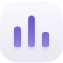
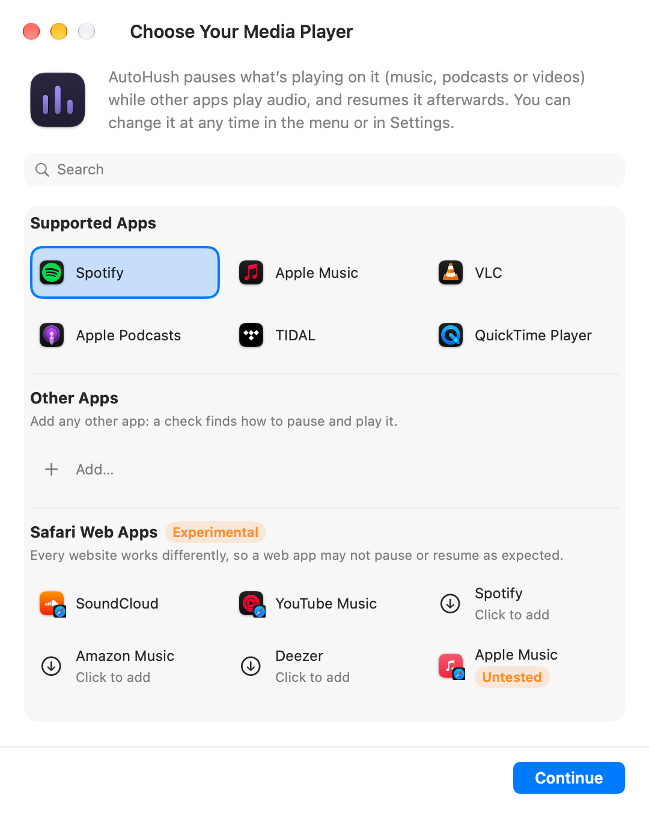
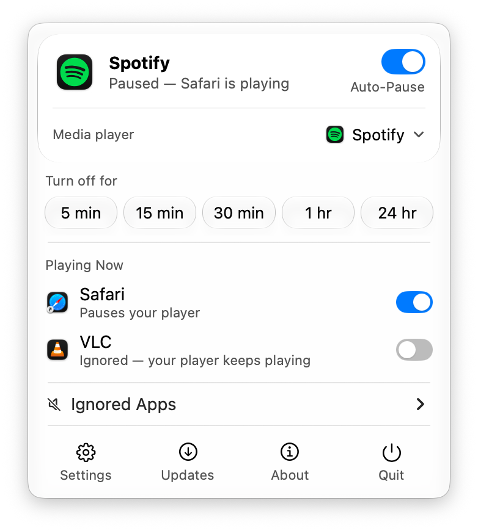
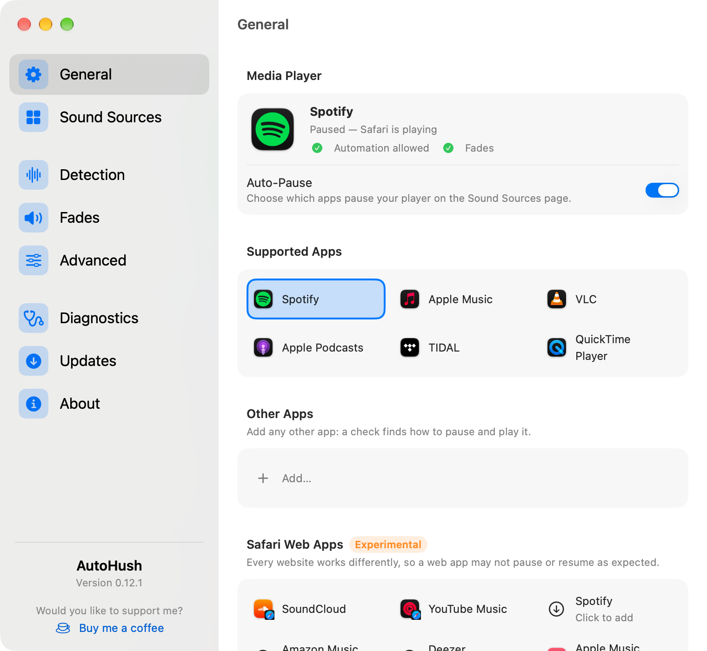

<h1 align="center">
  <picture>
    <source media="(prefers-color-scheme: dark)" srcset=".github/images/icon-dark.png">
    
  </picture>
  <br>AutoHush
</h1>
<p align="center"><strong>Whatever's playing steps aside when something else needs your ears.</strong></p>
<p align="center">
  <a href="https://github.com/hfustercabre/AutoHush/releases/latest"></a>
  <a href="https://github.com/hfustercabre/AutoHush/releases"></a>
  <a href="#install"></a>
  <a href="LICENSE"></a>
</p>
<p align="center">
  <a href="https://buymeacoffee.com/hfustercabre"></a>
</p>

## Meet AutoHush

AutoHush is a small menu bar app for macOS. When another app starts making sound (a YouTube video, a call, a game), it pauses what's playing in your media player: music, podcasts or videos. When that sound stops, it brings it back. You don't have to touch anything.

- 🎵 **Automatic:** pauses your player when another app plays, resumes it about 2 seconds after that app goes quiet.
- 🎚️ **Gentle:** playback fades out over 1 second before pausing and fades back in over 2 seconds when it resumes, and your volume is always left as it was.
- 🙋 **Respects you:** if you pause, play or quit your media player yourself, AutoHush takes that as your decision and won't override it.
- 🔕 **Ignores the noise:** notification sounds, alert beeps and short chat tones don't interrupt what's playing.
- 📱 **Knows where you're listening:** if Spotify plays on your phone, speaker or TV (Spotify Connect), it's left alone.
- 🚫 **Your rules:** choose apps that should never pause your player, or turn Auto-Pause off for a while.
- 🟣 **AntiDot mode:** an option that never shows macOS's purple recording dot.
- 🔒 **Minds its own business:** no accounts, no analytics, no tracking. It never records or saves sound, and it only goes online to check GitHub for updates, and to check once that a site you add as a web app answers (more under [Privacy](#privacy)).
- 🪶 **Featherweight:** built to sip, not gulp: about 0.1 to 0.2 % CPU and 30 MB of memory while it waits or your player plays, and under 1 % while it's working, so your battery won't notice it.

**Works with Spotify, Apple Music, VLC, Apple Podcasts, TIDAL and QuickTime Player**, for music, podcasts and videos, and, as an experiment, with websites added to the Dock from Safari, such as YouTube Music, Amazon Music or Deezer ([Safari web apps](#safari-web-apps)): choose yours in the menu or in Settings.

## Thanks to Background Music

AutoHush was inspired by [Background Music](https://github.com/kyleneideck/BackgroundMusic), the free, open-source audio utility by [Kyle Neideck](https://github.com/kyleneideck) and its contributors. Among many other things, it pauses your music while other apps play, and it did so long before AutoHush existed. My sincere thanks to Kyle for building it and sharing it with everyone: it showed me this could be done, and it's still well worth a look if you also want to set each app's volume.

So why write another one? To get your Mac's sound, Background Music routes it through a virtual audio device and reads it back from there, and macOS counts that as using a microphone. So while it runs, there's a yellow dot in the top-right corner of the screen and a yellow microphone icon in the menu bar, permanently. Nothing is being recorded, and macOS is right to point it out. Still, a yellow dot that never goes away tickles my 'tism in ways I couldn't ignore, so I built AutoHush with a different approach.

AutoHush leaves your sound where it is and only checks which apps are playing. It never uses the microphone, so the yellow dot never shows up. The only dot it ever shows is macOS's purple one, and only while another app plays over your player, which to my eyes is easier to ignore. If it still bothers you, [AntiDot mode](#the-purple-dot-and-antidot-mode) gets rid of it entirely, at the cost of slightly less precise detection.

Yes, this whole app exists because of a yellow dot.


## Contents

- [Install](#install)
- [First launch](#first-launch)
- [Using AutoHush](#using-autohush)
- [Shortcuts and Focus](#shortcuts-and-focus)
- [The purple dot and AntiDot mode](#the-purple-dot-and-antidot-mode)
- [Tips and troubleshooting](#tips-and-troubleshooting)
- [Privacy](#privacy)
- [Updates](#updates)
- [Uninstall](#uninstall)
- [Support AutoHush](#support-autohush)
- [For developers](#for-developers)

## Install

You need **macOS 14.4 or later**, on a Mac with Apple silicon or an Intel processor, and one of the supported players: **Spotify**, **TIDAL** or **VLC** (their desktop apps), **Apple Music**, **Apple Podcasts** or **QuickTime Player** (the Music, Podcasts and QuickTime Player apps that come with macOS), or a **Safari web app**, such as YouTube Music, Amazon Music or Spotify's web player added to the Dock from Safari (see [Safari web apps](#safari-web-apps)). Another app that plays can be your player too, once [Add an App…](#other-apps-add-an-app) has checked how to control it.

AutoHush is free and isn't sold through Apple. It's signed, but not *notarized* by Apple, because notarization needs a paid developer account. All that means for you is one extra confirmation the first time you open it, and Homebrew handles even that.

### With Homebrew (easiest)

```bash
brew install --cask hfustercabre/tap/autohush
```

This adds AutoHush's own tap, [hfustercabre/homebrew-tap](https://github.com/hfustercabre/homebrew-tap), and installs from it.

### By hand

1. Download `AutoHush-<version>.dmg` from the [releases page](https://github.com/hfustercabre/AutoHush/releases).
2. Open it and drag **AutoHush** onto **Applications**.
3. Open AutoHush. macOS refuses the first time, which is expected.
4. Go to **System Settings → Privacy & Security**, scroll down and click **Open Anyway** next to the AutoHush message. You only do this once: AutoHush installs later versions itself.

Prefer the Terminal? This replaces step 4:

```bash
xattr -dr com.apple.quarantine /Applications/AutoHush.app
```

### From the source code

```bash
git clone https://github.com/hfustercabre/AutoHush.git
cd AutoHush
bash Scripts/build-app.sh release
cp -R AutoHush.app /Applications/
open /Applications/AutoHush.app
```

## First launch

AutoHush lives in the menu bar; it shows in the Dock only while one of its windows is open, with the Mac's usual menus and keyboard shortcuts (⌘V to paste, ⌘W to close, ⌘Q to quit, Return and Escape for a window's buttons). The first time it opens, it asks which media player to control. A player counts as installed when it's in /Applications, your own ~/Applications or /System/Applications, not when it's elsewhere, such as on the disk image it came from. You can change your choice any time in the menu or in Settings.

<p align="center">
  <picture>
    <source media="(prefers-color-scheme: dark)" srcset=".github/images/welcome-dark.png">
    
  </picture>
</p>

macOS then asks for these permissions:

| Permission | What it's for | Needed? |
|---|---|---|
| **Control your media player** (Automation) | Pausing and resuming Spotify, Apple Music, VLC or QuickTime Player, or an app you added with Add an App… by its AppleScript. macOS asks for each player the first time you choose it | Yes, for Spotify, Apple Music, VLC and QuickTime Player, and an added app controlled by its AppleScript |
| **Accessibility** | Pausing and resuming TIDAL, Apple Podcasts and Safari web apps, which can't be scripted: AutoHush presses Play/Pause in TIDAL's Playback or Podcasts' Controls menu, or the web app's own Play/Pause button, and nothing else. An app you added is pressed the same way, in its menu, its page or its row in the menu bar's Now Playing panel, and Add an App's check needs it too | Only with TIDAL, Apple Podcasts, Safari web apps and Add an App… |
| **Audio Recording** (Screen & System Audio Recording, in System Settings → Privacy & Security) | Telling an app that's *playing* from one that just has its sound switched on but is silent, muting an added app that can only be muted, and judging one only its sound tells about | Yes, unless AntiDot mode is on (which doesn't use it, and can't mute or hear an app) |
| **Notifications** | Telling you about updates (without them, the menu bar icon still shows when one is found) | Optional |

The audio permission sounds scarier than it is: AutoHush only measures *how loud* other apps are, in memory, and never records or saves anything (see [Privacy](#privacy)). Without it, AutoHush still works, but a paused video may keep your player paused until you close it.

Right after you choose your player, the welcome window lists what it needs, each with a button: **Open Spotify** (macOS asks for Automation only while the player is open), **Allow…** (macOS's own prompt, or the right place in System Settings), or **Use AntiDot Mode Instead**, which needs no audio permission. **Done** unlocks once everything is allowed, and each line ticks by itself as you go. Wherever something else needs a permission (learning a web app, adding one, Settings), it says what's missing, offers the same button, and waits until it's allowed.

If you said no by mistake, the menu, Settings (General for the media player, Detection for audio recording) and those windows show the button that fixes it. Once you allow it, AutoHush starts by itself within a few seconds. Audio recording switched on in System Settings is the exception: macOS applies it only once AutoHush is opened again, so the button becomes **Reopen AutoHush**. If you take a permission away later, AutoHush notices when another app starts playing or when you open the menu, and asks for it again.

**Start it automatically:** click **Settings** at the bottom of the menu and turn on **Launch at login**.

## Using AutoHush

Every way through AutoHush, from its first launch to quitting it, is drawn as flowcharts in [WORKFLOWS.md](WORKFLOWS.md).

Click the menu bar icon to see what's going on. Its menu is AutoHush's own panel: its parts fold and unfold smoothly (at once with Reduce Motion), and Escape or a click elsewhere closes it. As in macOS's own menus, the card at the top and the buttons at the bottom stay put; when the menu is taller than your screen, only what's between them scrolls.

<p align="center">
  <picture>
    <source media="(prefers-color-scheme: dark)" srcset=".github/images/menu-dark.png">
    
  </picture>
</p>

- **The card** shows your media player and what's happening, such as "Playing", "Paused — Safari is playing" or "Playing on another device", and under it, as in Settings, what AutoHush can do with it: its permission allowed, and whether it fades. Anything that needs your attention shows in orange, with a row under the card to fix it, or a **Retry** button when the player didn't answer. When the player answered with an error ("Can't control TIDAL right now") or refused to pause ("Couldn't pause — Safari is playing"), an ⓘ ends the line: click it to see why. Settings → Diagnostics shows it too, as **Last error**.
- **Auto-Pause**, on the card, turns everything on or off. Turning it off brings back what AutoHush paused.
- **Media Player**, under the card, shows your player and what kind it is; its row unfolds the players to choose from (choosing one keeps the menu open, the card showing what the new one can do), with a checkmark on yours (↑ and ↓ move through them, Return chooses): under **Supported Apps**, the most used first; those not on your Mac are dimmed and listed after them. The apps you added yourself follow, under **Other Apps** (see [Other apps](#other-apps-add-an-app)), with **Add an App…** after them, and your Safari web apps come last, under their own heading: the tested ones first (Spotify, YouTube Music, Amazon Music, Deezer, SoundCloud), then those of them you haven't added yet, then any other, marked **Untested**. With eight players or more, not counting the ones you haven't added, a search comes first (and in the welcome window too). The players you didn't choose count like any other app: if one plays, it pauses your player, unless you ignore it.
- **Turn off for** pauses AutoHush itself, from 5 minutes to 24 hours, in one click.
- **Playing Now** lists the apps playing sound, each with a switch: turn it off for an app that shouldn't interrupt your player, such as a game whose soundtrack you don't mind.
- **Recently Played**, under it, lists the apps that played in the last 30 minutes, with the same switches: handy for one that stopped before you could switch it off.
- **Ignored Apps** names the apps you've switched off; its row unfolds them. Click one to undo. AutoHush adds BetterDisplay, MonitorControl and Lunar itself the first time they run (and again after **Reset List…**), since they play only the volume sound.
- **More settings:** under Ignored Apps, Settings' Detection, Fades and Advanced switches (AntiDot mode, Fade playback, Level the volume, Stay paused after calls), each under its section's name with a few words on what it does, so you can change them without opening Settings. The small arrow under Detection unfolds its ways of detecting and its timings, and the one under Fades the fade lengths; each stays as you left it each time you open the menu (folded at first, and again when AutoHush restarts). As in Settings, what doesn't apply is greyed out rather than hidden: the fade lengths while fades are off, the silence threshold in AntiDot mode, and its ways of detecting while it's off. A switch that can't be changed shows off, with a line under it saying why ("TIDAL can’t be faded.", "Off in AntiDot mode.").
- **The buttons at the bottom** open Settings, check for updates, open Settings → About, and quit. When an update is available, **Updates** shows in the accent color and a row above the buttons offers to install it.
- **The menu bar icon** shows what's happening: sound bars while your player plays, a dot and a pause sign when AutoHush paused it, three dots when nothing plays, an arrow when it plays on another device, hollow bars while starting, and "!" when something needs your attention. It's dimmed while Auto-Pause is off.

### Safari web apps

Any website you add to the Dock from Safari (open it, then **File → Add to Dock**) can be your media player: YouTube Music, Amazon Music, Spotify's web player, or any other. AutoHush lists your web apps under **Safari Web Apps** wherever it offers players, each with Safari's icon on its own, so a web app isn't taken for an app of the same name (Spotify's web player and its app). Support for them is **experimental**, and says so: every website works differently, so a web app may not pause or resume as expected. AutoHush has been tested with **Spotify, YouTube Music, Amazon Music, Deezer and SoundCloud**: their web apps are listed first. Any other web app is listed after them, marked **Untested**: it may work just as well, but nobody has checked. A tested site's web app is listed under the site's name ("YouTube Music", whatever Safari called it), and any other under its page's title without the slogan after " | " or a dash.

AutoHush can make one for you, too: choose **Add a Web App…** (last among the players in the menu, or the last tile in Settings → General and the welcome window) and paste the website's address. The tested sites, Spotify, YouTube Music, Amazon Music, Deezer and SoundCloud, are listed with a download symbol until you add them; choosing one opens the window with its address filled in. Amazon Music has its own site in some countries, and you can sign in only on your account's: the window opens the one for your Mac's region and, under the address, lets you choose your account's country (or Other Countries, for music.amazon.com). Then:

1. AutoHush checks the address and asks the site once whether it answers, then opens it in Safari.
2. Once the site shows there, click **Add to Dock** in AutoHush's window: AutoHush opens Safari's own **Add to Dock** window, where you can change the web app's name, and you click **Add** there. If you close Safari's window with **Cancel**, the step says so and **Add to Dock** opens it again.
3. AutoHush then chooses the new web app and opens it, and the same window learns its controls.

While it adds and learns, the window stays above other apps, in the top-right corner of the screen, so Safari and the web app don't hide it (the learning window does too).

- Safari makes the web app from the page it shows, so if the site asks something first on another of its addresses (YouTube's cookie page on consent.youtube.com, in Europe, or a sign-in page), an **Answer the site in Safari** step waits until you've answered and the site itself shows. Answer anything else it asks (a cookie banner) before clicking Add to Dock.
- If a Safari extension asks for access to the site while it opens, answer it first: Safari can't add the site while it waits.
- A website that already has a web app isn't added again.
- **Cancel**, or closing the window, stops it before anything is added (Safari's dialog is cancelled too); once added, the Safari tab AutoHush opened is closed (its window, when it's the only tab there).
- Adding it this way needs the **Accessibility** permission, as controlling it does.

Web apps can't be scripted and have no playback menu, so AutoHush presses the site's own Play/Pause button, and the site stays in step. Sites differ, and their buttons are named in the site's language, so AutoHush learns the button with you:

1. When you choose a web app, a window asks you to **play something in it** and click **It's Playing**. Log in to the site first if it asks (a site that needs an account plays nothing until you do), and click It's Playing only once what you chose plays: during an ad, the site's own button may say it's paused.
2. AutoHush then pauses it itself with the keyboard's Play/Pause key (**Let AutoHush pause it**), sees which button changed, and plays it again. That's all; it closes by itself.
3. macOS sends that key to the app it counts as playing, "Now Playing": the last one that started to play. If that's another app (one that started after the web app, say), AutoHush doesn't press the key at all, and goes straight to the step where you pause it yourself (below). If the key doesn't take (the site may ignore it), it presses it again to undo it and marks the step failed, with **Try Again** and **Pause It Manually**. The latter adds a step: **pause it yourself** and click **It's Paused**; the button that changed between the two is the one. Paused by hand, you have a minute to pause it and click It's Paused (a line under the step counts down); then it starts over.

If Accessibility isn't allowed yet, its first step asks for it, and the others unlock once it is. A click AutoHush can't take says why under its step: It's Playing while it can't hear the web app, or can't read its page (it isn't open, has no window, or shows its buttons without their names, as a window macOS reopens at login can: open its window, or close it and open it again), or It's Paused while no button has changed.

The steps show only in these windows. If you close the window with **Later**, the **Controls** row in the menu's card and in Settings → General says they aren't learned yet, and its **Learn Controls…** button opens a new window that starts from the first step. Until it knows the button, AutoHush presses nothing on the page.

- It works with the web app's window visible, minimized, or on another Space (another desktop). With more than one window of the same web app, AutoHush follows the one that plays. Closing the window stops playback, as it does in Safari.
- It needs the **Accessibility** permission, and pauses and resumes without fading.
- **When a site won't pause,** AutoHush mutes the web app instead: during an ad that can't be paused (the site disables its button, or the button reads "Play" while the ad plays, as on YouTube Music), or when a press doesn't take. As soon as the site can be paused (the ad is over and what you chose plays), AutoHush pauses it and unmutes it, so you don't miss any of it, and plays it when the other app stops. It never mutes a web app that paused. Muting uses macOS's own per-app audio taps, so it needs the audio permission and isn't available in AntiDot mode.
- If the site changes so much that the button can't be found for a minute while the web app plays, AutoHush asks you to tell it once more when it plays and when it's paused, and remembers both layouts. A page that isn't playing doesn't count: a fresh YouTube Music window shows its player bar only once something plays.
- **If AutoHush pauses or resumes a web app at the wrong times,** it may have learned the wrong button, or its words the wrong way round: **Learn Again…** in the **Controls** row (in the menu's card and in Settings → General) asks you once more, in a new learning window, to tell it when the web app plays. What it learned keeps working until you click **It's Playing** there, and is forgotten only then: close the window before that (or click **Later**) and nothing changes. A learning window still open is closed and starts over.
- Deleting the chosen web app leaves no player chosen, and the window to choose another opens: adding the site again makes a new web app, which learns its button again.
- **Settings → Diagnostics** shows whether the button has been learned.

### Other apps: Add an App…

AutoHush can also control an app it doesn't support itself, once it has checked how: choose **Add an App…** (after **Other Apps** among the players in the menu, or the **Add…** tile under Other Apps in Settings → General and the welcome window). A window lists the steps:

1. **Choose the app.** **Choose an App…** opens the list of the apps on your Mac that can play, those in macOS's Now Playing first, with a search; **Other App…** picks any other app on your disk. A web app made by Chrome, Brave or another Chromium browser shows that browser's icon on its own, and its name under it, so two web apps of one site aren't confused. Apple's apps that aren't media players (Mail, Maps, Notes, Xcode…) and the players AutoHush supports aren't listed. If the app isn't open, AutoHush opens it in the background.
2. **Allow what the check needs**, only what that app needs, all at once. **Accessibility** is needed: the check reads the app's menus and page, moves its window and blocks the mouse and keyboard with it. **Audio Recording** is optional: without it, or in AntiDot mode, which taps no sound, the check can't mute only the app, so AutoHush mutes your Mac's sound while it runs and puts it back after. **Automation** is asked for only when the app can be scripted, and is optional too: without it, its AppleScript isn't tried. A warning says what the check does without the ones you leave out, with **Continue**; with everything allowed it goes on by itself.
3. **Reopen it**, only for an app built with Electron (Deezer, Qobuz…) that was opened without the option its page needs to be pressed while its window is covered or on another desktop. AutoHush asks first, since reopening stops whatever it plays; **Skip** goes on without, and AutoHush can then pause it only while its window can be seen.
4. **Play something in it.** AutoHush goes on as soon as the app plays, within 2 minutes. With Audio Recording, outside AntiDot mode, it listens for the app's sound, so an app that keeps its sound output open while paused doesn't count; otherwise an open sound output does.
5. **The check.** **Continue…** first shows what it does: for about 3 minutes, AutoHush pauses and plays the app every way it can find (its AppleScript, its playback menu, its page's Play/Pause, its row in the menu bar's Now Playing panel), with its window in 7 states: in view, covered, on another desktop, covered there, full screen, minimized and hidden. The app is muted meanwhile: on its own with Audio Recording and outside AntiDot mode, else with your Mac's whole sound (unless its output has no mute control, as some HDMI and USB ones), put back as it was afterwards, even if AutoHush quit meanwhile. While AutoHush moves windows, it blocks clicks, scrolling and keys (the pointer still moves, except during a drag) and dims the screen, except a small panel at the bottom right with the progress and **Stop**, on every desktop. **Escape** or **Stop** ends the check; whenever it asks you something, the mouse and keyboard are yours again. Windows, desktops and sound are put back as they were, also when you stop it. A player AutoHush paused stays paused until the check ends (the menu says **Paused while a check runs**).
6. **See what worked, and use it.** The ways that worked, everywhere or with the window in some states, are cards to choose from: the recommended one first, chosen until you pick another (the Now Playing panel comes last, as it opens on screen for a moment); the ways that didn't work are listed under them, with why. **Use** adds the app under **Other Apps**, marked **Checked by you**, and makes it your media player, paused and played only the way you chose: when that way can't (a page's button with the window minimized, say), the pause fails and the menu says so. To remove an app you added, click the **×** on its tile in Settings → General or the welcome window (it shows under the pointer or with the keyboard's focus), right-click the tile, or hold **⌥ Option** in the menu's list of players, where its row becomes **Remove <app>…**; AutoHush asks first. Removing your current player opens the window to choose another. The app stays on your Mac, and Add an App can check it again. A finished check waits for **Use** for up to a day, so closing the window or reopening AutoHush doesn't mean checking again; checking another app replaces it.

- **A page's switch:** for an app built with Electron, Chromium or Flutter, AutoHush turns on the app's switch for assistive tools (as VoiceOver does) to read its page, and keeps it on while the app is your player (a browser's switch, shared by its web apps, while any of them needs it).
- **If the app was opened without its option** while it's your player (from the Dock, say), the menu bar icon shows "!", the card says it needs reopening, and **Reopen** (there and in Settings → General) reopens it as it needs. Choosing such an app as your player asks first, in an alert; with **Always reopen … this way** ticked there, AutoHush reopens it so from then on, without asking, whenever it finds it opened without its option.
- **If no way works** (an app with no AppleScript, no playback menu, a page whose button doesn't change, and no working Now Playing row), the last step says so and offers **Mute It Instead**: AutoHush then mutes the app while other apps play, never pausing it, so it keeps playing, silent, and is heard again when they stop (you miss that part of it). The menu says "Muted — Safari is playing", with **Unmute** (Settings → General has it too), and the app is marked **Muted instead of paused** among the players (**Muted only** on its tile). Pausing it and playing it again yourself while it's muted (stopped for 3 seconds or more, so a gap between songs doesn't count) unmutes it, and AutoHush leaves it alone until the other apps stop, as when you play a paused player yourself. Muting uses macOS's per-app audio taps, so it needs Audio Recording and isn't available in AntiDot mode: there the last step doesn't offer it (it offers **Turn Off AntiDot Mode** instead), and an app added that way is dimmed among the players, marked **Not in AntiDot mode** (**Not in AntiDot** on its tile), and while such an app is your player, the AntiDot mode switch is off and dimmed. Quitting AutoHush always unmutes it. The check's log, the newest `… check.log` in `~/Library/Logs/AutoHush/Checks`, says what was tried, leaving out your Mac account's name and what was playing: you can [ask for the app](https://github.com/hfustercabre/AutoHush/issues/new/choose) with it.
- **The Now Playing panel** needs Now Playing in the menu bar (System Settings → Menu Bar; Control Center on macOS 14 and 15). If you hid it there, AutoHush shows it for the moment of a press and hides it again (in under a second, without touching anything else). It leaves the setting alone if you changed it meanwhile, and should AutoHush or its check quit during a press, your setting is put back afterwards. Only if it can't be shown does the check mark the panel as not tried and a pause through it fail, both saying where to show it, with **Open Menu Bar Settings…** to go there; once you've shown it, **Check Again**, beside **Use**, checks the app again. Whatever covers its icon (a wide app's menus by the notch, another app's window) doesn't matter: AutoHush finds it in the menu bar's own windows. Some apps' rows there never show whether they play (Qobuz's always shows paused): the check then presses the row as a toggle when the app's sound says otherwise, and AutoHush does the same, listening to the app for half a second just before it pauses or plays it. That needs Audio Recording, so in AntiDot mode such a way can't be chosen, and an app added that way is treated as one that can only be muted: dimmed among the players, and while it's your player the AntiDot mode switch is off and dimmed.
- Apps added this way pause and resume without fading, unless they're controlled by an AppleScript that has a volume.

### Settings

<p align="center">
  <picture>
    <source media="(prefers-color-scheme: dark)" srcset=".github/images/settings-dark.png">
    
  </picture>
</p>

Settings has a page for each of these in its sidebar, which also shows AutoHush's version and a link to support it. You can resize the window; it opens where you left it.

| Page | What you'll find |
|---|---|
| **General** | Your media player, with what it's doing, whether AutoHush may control it and whether it fades, and the **Auto-Pause** switch · every player as a tile, to choose another (the apps under **Supported Apps**, the apps you added under **Other Apps** with an **Add…** tile for Add an App, then the Safari web apps and **Add…**) · Launch at login |
| **Sound Sources** | Every app that has played sound, each with a switch for whether it **pauses** your player, sorted by **Last Played** (the default), **Name** or **On/Off**; the arrow beside **Sort by** reverses the order, and the magnifier searches the apps by name. **Ignore Another App…** adds one before it ever plays. Click an app and **Remove** takes it off the list (an app you turned off asks first, since it would then pause your player again), or use **Reset List…** to start over |
| **Detection** | [AntiDot mode](#the-purple-dot-and-antidot-mode) · **Timing:** how long an app must play before your player pauses (0.5 s), how long it must be quiet before your player resumes (2 s, at least 1 s), and what counts as silence (−60 dB; greyed out in AntiDot mode, which doesn't measure sound) · **Restore Defaults** for these timings |
| **Fades** | A switch that turns them on or off, then how long playback fades out before pausing (1 s) and back in when it resumes (2 s), where 0 turns one fade off, greyed out while the fades are off; all dimmed with a player that can't fade (TIDAL, Apple Podcasts, Safari web apps, and an app added with Add an App… unless it's controlled by an AppleScript with a volume) · **Restore Defaults** for the fades |
| **Advanced** | **Level the volume** (off by default): when the apps your player was paused for were quieter than it, by 2 dB or more, it resumes with the Mac's volume lowered to match (10 dB at most), until the next pause, when the volume goes back up as it fades out. Calls (an app using the microphone) don't count, and if you change the volume meanwhile, yours stays. It needs an output with a volume control (not HDMI or DisplayPort) and is off in AntiDot mode · **Stay paused after calls** (off by default): your player isn't resumed when a call came while it was paused · **Restore Defaults** turns both off |
| **Diagnostics** | What AutoHush sees right now: how it's doing, every app with its sound on and how it judges it (playing, ignored, silent) and why, then your media player (with its last error, for an app you added how it's controlled, and for TIDAL and Apple Podcasts whether their own words for Play and Pause could be read), the detection and its timings, each permission and whether it's allowed, AutoHush's own settings, and your Mac. Each part folds away under its heading. It's updated as it happens. **Copy Report** copies it all, to send with a bug report, and **Show Logs…** opens what AutoHush logged (this launch or the last 24 hours, every entry or only problems), to copy or save too |
| **Updates** | Automatic checks, what happens when an update is found (see [Updates](#updates)), and **Check Now** |
| **About** | AutoHush's version, what it does and the players it works with, links to GitHub, the release notes and a new issue, and a link to support AutoHush |

AutoHush uses macOS's own controls, text styles and colors, so it looks like the macOS it runs on; from macOS 26, its menu's panel and card are Liquid Glass.

### Language

AutoHush speaks 35 languages: English, Spanish (Spain and Latin America), Catalan, German, French (France and Canada), Italian, Portuguese (Brazil and Portugal), Dutch, Swedish, Danish, Norwegian, Finnish, Polish, Czech, Slovak, Hungarian, Romanian, Croatian, Slovenian, Greek, Ukrainian, Russian, Turkish, Arabic, Hindi, Indonesian, Vietnamese, Japanese, Korean and Chinese (Simplified, Traditional, and Traditional for Hong Kong). In Arabic it reads right to left. It uses the first of your Mac's preferred languages that it has (System Settings → General → Language & Region), and English otherwise. To give AutoHush a language of its own, add it to the Applications list in that same pane.

> [!WARNING]
> Only English, Spanish (Spain) and Catalan have been checked by a native speaker. The other languages were translated automatically, so they may contain mistakes or odd wording. If you spot one, please [report it](https://github.com/hfustercabre/AutoHush/issues/new?template=translation.yml) with the text and a better wording.

## Shortcuts and Focus

AutoHush's **Auto-Pause** switch can also be set from the Shortcuts app and by a Focus:

- **Three actions** in the Shortcuts app:
  - **Set Auto-Pause** turns it **On** or **Off**, or switches it with **Toggle**. Off lasts until it's turned on again, and On also ends a **Turn off for**.
  - **Turn Off Auto-Pause For** turns it off for 5 Minutes, 15 Minutes, 30 Minutes, 1 Hour or 24 Hours, as the menu's buttons do, and it comes back on by itself.
  - **Get Auto-Pause** tells whether it's on now: it isn't while it's off or turned off for a while.
- **Ready-made shortcuts:** "Turn off Auto-Pause in AutoHush" and "Turn on Auto-Pause in AutoHush" work in Shortcuts, Spotlight and Siri with nothing to set up.
- **A Focus filter:** in System Settings → Focus, choose a Focus, click **Add Filter…** under **Focus Filters**, choose **AutoHush** and set **Auto-Pause** to On or Off. While that Focus is on, Auto-Pause follows it. When the Focus ends, Auto-Pause goes back to how it was, unless you changed it meanwhile. That works even if AutoHush quit or the Mac restarted during the Focus.

The actions change the running AutoHush, and the menu shows the change at once; if AutoHush isn't running, macOS opens it in the background first. They need no permission. A copy you build from the source code lists them, but runs them only when it's signed with an Apple developer certificate (see [DEVELOPMENT.md](DEVELOPMENT.md#signing-and-releases)).

## The purple dot and AntiDot mode

To hear whether another app is *really* playing, AutoHush has to measure its sound level. Whenever an app does that, macOS shows a **purple dot** in the menu bar. It's a privacy feature that no app can hide, and that's a good thing.

AutoHush keeps the dot to a minimum: it only measures while the answer matters, that is while your player is playing on this Mac (or was paused by AutoHush) and another app has its sound on. Your media player itself is never measured, except in two cases. Rarely, an app you added doesn't tell clearly whether it plays (its Now Playing row doesn't show its state, or it reports being paused while its sound is on): AutoHush then listens to it for half a second, just before pausing or playing it, or once per such report, so the dot shows then. And with **Level the volume** on, it's measured while another app is anyway, to know how loud the music was. So:

- Your player playing on its own, paused, or on another device: **no dot**.
- Another app playing over your player: the dot shows while that app has its sound on, plus 2 seconds.
- An app that keeps its sound on while silent (some players do, paused): the dot shows for its first 10 seconds of silence, then AutoHush stops measuring it until it opens its sound again or tells macOS it plays. An app that keeps telling macOS it plays (a call) stays measured, so its next sound is heard.

**If the dot bothers you, turn on AntiDot mode** (Settings → Detection). AutoHush then never measures any sound, so the dot never appears. Instead, it goes by what apps tell macOS: most players and browsers say "I'm playing, don't go to sleep" while they play, and stop saying it when you pause. It needs no extra permission, and treats every app the same way.

The catch is that it's a little less precise (measured on macOS 27):

| | Normal mode | AntiDot mode |
|---|---|---|
| Purple dot | Sometimes, while needed | Never |
| Playback pauses for a video | After 0.5 s | After 0.5 s (3 s in apps that don't say when they play, like QuickTime) |
| …for sound without video | After 0.5 s | After 3 s, so that notification sounds don't pause it |
| Playback comes back after you pause Firefox | ~2 s | ~2 s |
| …Chrome | ~2 s | ~4.5 s (Chrome keeps saying it plays for 2.5 s) |
| …a Safari video | ~2 s | ~2 s once AutoHush has seen Safari play a video in the background, ~9.5 s before that |
| …QuickTime, or Safari playing sound without video | ~2 s | ~9.5 s (they don't say when they play, so AutoHush waits for them to switch their sound off) |
| A notification sound in an app that doesn't say when it plays | Ignored | Pauses playback for about 10 s |
| An app that never says it's playing and keeps its sound on while paused | Playback comes back | Playback stays paused until you close that app |
| A muted video | Playback comes back | Playback comes back in Chrome and Firefox, stays paused in other apps |

AntiDot mode offers two ways to detect playing apps: **What apps tell macOS** (recommended), as described above, or **Open audio streams only**, where any app with its sound switched on counts as playing, even when paused: simpler, but stricter. There, any app's sound must stay on 2 seconds before your player pauses, so notification sounds don't pause it either.

## Tips and troubleshooting

- **Another app paused your player as it started?** Some apps pause other players themselves when they play: VLC does with Spotify and Apple Music, unless **VLC → Settings → Interface → Control external music players** says **Do nothing**. AutoHush resumes that pause like its own when the app stops, but only if your player stopped as the app's sound began: within a second after (or up to half a second before, as AutoHush hears an app a moment late). It works with the players that report a pause at once, such as Spotify and Apple Music, the ones VLC pauses.
- **I paused my player myself and it stayed paused.** That's on purpose: AutoHush only resumes what *it* paused, or what another app paused just as it started.
- **Your player stayed paused after the Mac slept.** That's on purpose too, as media players do after a sleep: the other app's sound stops when the Mac falls asleep, which isn't it ending. Play it again when you want it.
- **Switched players?** If AutoHush was holding your previous player paused, it keeps watching it and plays it again when the other apps stop, as it would have, even if AutoHush quits and opens again meanwhile. It leaves it alone if you play or quit it yourself first; choosing it again takes the pause back; and the Mac sleeping forgets it, as any pause. Apart from that, the previous player counts like any other app.
- **TIDAL, Apple Podcasts and Safari web apps pause without fading.** AutoHush can't read or set their volume, so it pauses and resumes them straight away. It notices when you pause or play them yourself (and VLC and QuickTime Player) within about a second. If an update changes TIDAL's Playback or Podcasts' Controls menu, AutoHush may not be able to control them until AutoHush is updated too.
- **QuickTime Player pauses every movie or recording it's playing,** and plays again those it paused, fading each one's own volume.
- **Deezer's app can be added with [Add an App…](#other-apps-add-an-app).** It can't be scripted and ignores its menu's presses, but its page's Play/Pause works, once it's opened with the option Add an App asks to reopen it with. Its web player works too, as a [Safari web app](#safari-web-apps). If you find a way to control an app Add an App can't, please [open an issue](https://github.com/hfustercabre/AutoHush/issues) explaining it, or send a [pull request](https://github.com/hfustercabre/AutoHush/pulls). Either way, it has to keep to AutoHush's principle of being as unintrusive as possible: no virtual audio devices or microphones, and nothing that reroutes your Mac's sound.
- **Only one AutoHush runs at a time.** Opening another copy (a newer version, a second install) quits the one that's running, and takes over any pause it was holding. Delete the copies you don't use.
- **Your player keeps playing during a video.** Check that the app isn't ignored (menu → Ignored Apps) and that Auto-Pause is on.
- **Your player stays paused after a video ends.** Some apps keep their sound switched on after playback. Allow audio recording, or in AntiDot mode close the app or tab.
- **Something looks off?** **Settings → Diagnostics** shows what AutoHush sees (hold **⌥ Option** and click **Settings** in the menu to go straight there), and **Copy Report** copies it for a bug report. **Show Logs…**, beside it, shows what AutoHush did and what went wrong.
- **"Spotify isn't running", a permission warning, or "isn't responding".** Fix the cause and AutoHush starts by itself: when the player opens, a few seconds after you allow access (audio recording: once you reopen AutoHush), or once the player answers again (it keeps trying, up to once a minute). **Retry** on the card tries again at once.
- **A permission AutoHush asks for is already switched on in System Settings?** That can happen once, after you replace AutoHush 0.12.1 or earlier with 1.0.0 or later by hand: from 1.0.0 AutoHush is signed with another certificate, and the switch belongs to the old copy. In **System Settings → Privacy & Security**, open that permission's list (Accessibility, say), select AutoHush, remove it with **−**, then allow AutoHush again.

## Privacy

- AutoHush **never records, saves or sends audio**, and never uses the microphone.
- With the audio permission, it reads other apps' sound only to work out how loud it is, in memory, and throws the rest away. It does the same, for half a second, only in a few rare cases: a web app that can be heard while its button says it's paused (an ad), and an app you added that doesn't tell clearly whether it plays (its Now Playing row doesn't show its state, or it reports being paused while its sound is on), just before pausing or playing it, or once per such report. Only with **Level the volume** on, it also measures your player while another app plays, to match their loudness. In AntiDot mode it doesn't look at any sound at all.
- It only goes online to check GitHub for a new version once a day, to download that version from GitHub, and to check a website you add as a web app (below). You can turn off the first two (see [Updates](#updates)). None of them leaves a cache or cookies on your Mac, and a downloaded update is kept for at most 7 days.
- Its only notifications are about updates.
- It keeps a log of what it does on your Mac only, in `~/Library/Logs/AutoHush/AutoHush.log`: the last 24 hours at most, private details left out (when a player answers with an error, only its number, never its message, which can name what was playing). **Settings → Diagnostics → Show Logs…** shows it; it leaves your Mac only if you copy or save it.
- While it learns a web app's controls, it asks macOS which app is Now Playing, only to know whether its Play/Pause key would reach the web app.
- It controls only the media player you chose: Spotify, Apple Music, VLC and QuickTime Player through the standard macOS automation mechanism, TIDAL and Apple Podcasts by pressing Play/Pause in their Playback or Controls menu, a Safari web app by pressing the site's own Play/Pause button, and an app you added with Add an App… the way you chose. With Now Playing hidden in the menu bar, AutoHush and its check show it for the moment of a press, then put your setting back.
- **Add an App's check** reads only the chosen app: its scripting dictionary, its menus, its page's buttons, its sound's level (in memory, as above; not in AntiDot mode) and, on an administrator's account, what it reports to Now Playing in macOS's log. It keeps in AutoHush's preferences how to control the app (the way you chose, and its page's Play/Pause words and place, or its Now Playing row's text, below) and a finished check not used yet, for a day at most; what it learned of the app in `~/Library/Caches/com.autohush.AutoHush/PlayerCheck` (where its page's Play/Pause is, its own words for Play and Pause, and the text of its row in the Now Playing panel, which is what was playing then), so the next check starts from there; and a log of each check (and Reopen) in `~/Library/Logs/AutoHush/Checks` (the last 50 runs), which leaves out your Mac account's name and what was playing.
- **With an app you added as your player,** AutoHush also reads what that app reports to Now Playing from macOS's log while AutoHush runs, on an administrator's account, whenever the app's other signs don't tell whether it plays: only the lines macOS's Now Playing service writes about apps' playback, in memory. If it's controlled through the menu bar's Now Playing panel, AutoHush keeps the text of the panel row it last pressed in its preferences, to find that row again: that text is what was playing then (its title, artist and album).
- When you add a web app from its address, it asks that website once whether it answers, without cookies or a cache, before opening it in Safari.
- With a Safari web app, it reads the names of the page's buttons, in memory, to find its Play/Pause button. It keeps only that button's two words ("Play", "Pause", in the site's language) and where the button is, never what you listen to or anything else on the page.

## Updates

AutoHush checks GitHub for a new version once a day. What happens when it finds one is up to you (Settings → Updates → **When an update is found**):

| Choice | What happens |
|---|---|
| **Notify me** | A notification tells you, and the menu offers to install it |
| **Download it and notify me** | AutoHush downloads it, then a notification tells you it's ready. Installing it takes a second |
| **Install it automatically** (the default) | AutoHush installs it at a moment when it isn't holding your player paused and none of its windows or menus are open, then a notification says it was updated |

Until it's installed, AutoHush's menu bar icon shows a small arrow in its corner, the menu's **Updates** button shows in the accent color and a row above it offers **Install AutoHush** with the new version. Both open a window with what's new and a button to **Download and Install**, or **Install and Relaunch** once it's downloaded; clicking a notification opens it too. Installing swaps in the new version and restarts in about a second. Your settings and permissions carry over, and if AutoHush has your player paused for another app, the new version takes that pause over.

**Notifications:** AutoHush asks for them when it first starts. While they're off, every choice still works and the menu bar icon shows when an update is found; Settings says notifications are off, with a button to turn them on. If you reset AutoHush's notifications in System Settings, it asks again.

**Downloads** wait in `~/Library/Caches/com.autohush.AutoHush/Updates`, one at a time. A download is deleted once it's installed or out of date, when you change the choice or turn automatic checks off, or after 7 days (the menu still offers the update). Automatic downloads wait while Low Data Mode is on.

**Before installing**, AutoHush checks that the download matches the checksum GitHub lists for it, that it's the version GitHub announced, that a kept download hasn't changed since, and that the app inside is signed by the same developer team as your copy (the check macOS itself uses to keep AutoHush's permissions), so nothing but a genuine AutoHush gets installed this way.

**Updates** in the menu, or **Check Now** in Settings, checks right away; turn off automatic checks to only check when you ask.

AutoHush can only update itself from a folder it can write to, such as Applications on an administrator account; Settings tells you when it can't. Then update by hand: `brew upgrade --cask autohush`, or download the new version and replace the old one. Versions up to 0.2.0 can't update themselves: update those once by hand. Versions up to 0.12.1 can't install 1.0.0 or later, which are signed with another certificate: they say they couldn't install the update, and **Open Release Page** leads to it. Update those once by hand too; macOS then asks for **Open Anyway** again (see [By hand](#by-hand)) and may ask for some permissions again (see [Tips and troubleshooting](#tips-and-troubleshooting)).

## Uninstall

1. In Settings, turn off **Launch at login**, then quit AutoHush.
2. Delete `/Applications/AutoHush.app`, or run `brew uninstall --cask autohush`.
3. Optional: delete its settings (the apps you added with Add an App… among them), caches (a downloaded update that may be waiting, and what Add an App's checks learned, in `PlayerCheck`) and logs (the checks' too, in `Checks`), and forget the permissions you allowed:

   ```bash
   defaults delete com.autohush.AutoHush
   rm -rf ~/Library/Caches/com.autohush.AutoHush ~/Library/HTTPStorages/com.autohush.AutoHush ~/Library/Logs/AutoHush
   tccutil reset All com.autohush.AutoHush
   ```

   With Homebrew, `brew uninstall --zap --cask autohush` deletes the app, its settings and its caches in one go; the permissions still need the `tccutil` line. If you also built and ran the Player Check tool from the source code, it keeps its own caches, logs and checks in `~/Library/Caches/PlayerCheck`, `~/Library/Logs/PlayerCheck` and `~/Library/Application Support/Player Check`, and its settings as `com.autohush.tools.playercheck`.

4. Optional: to remove AutoHush from System Settings → Notifications, right-click it there and choose **Reset Notifications…**.

## Support AutoHush

AutoHush is free. If it saves your ears a few times a day and you'd like to say thanks, you can buy me a coffee. It helps me keep improving it. The link is also in **Settings → About** and at the bottom of Settings' sidebar.

<p align="center">
  <a href="https://buymeacoffee.com/hfustercabre"></a>
</p>

---

## For developers

How AutoHush works, its architecture, building and testing it, translations, contributing and releases are in [DEVELOPMENT.md](DEVELOPMENT.md); what it does, step by step, in [WORKFLOWS.md](WORKFLOWS.md). To propose a change, see [CONTRIBUTING.md](CONTRIBUTING.md); for how AutoHush looks and reads, [STYLE_GUIDE.md](STYLE_GUIDE.md).

## License

[MIT](LICENSE)
