# AutoHush Workflows

What AutoHush does, and what you can do with it, from launching it to quitting it, drawn as flowcharts. They follow the code; [README.md](README.md) says the same in words, and [DEVELOPMENT.md](DEVELOPMENT.md) how it's built.

**Reading them:** a rounded box is where a path starts; a diamond, a question that picks the branch; a dashed purple box, a step that goes on in another chart below; orange, something that went wrong or needs you; green, where a path settles; a dotted line, something that happens sometimes, or at any time.

- [Overview](#overview)
- [First launch and setup](#first-launch-and-setup)
- [Monitoring: pausing and resuming](#monitoring-pausing-and-resuming)
- [Monitoring: what else changes it](#monitoring-what-else-changes-it)
- [The player’s states](#the-players-states)
- [Pauses AutoHush holds](#pauses-autohush-holds)
- [Safari web apps: adding one](#safari-web-apps-adding-one)
- [Safari web apps: learning and pausing](#safari-web-apps-learning-and-pausing)
- [Add an App: before the check](#add-an-app-before-the-check)
- [Add an App: the check and its result](#add-an-app-the-check-and-its-result)
- [An added app in use](#an-added-app-in-use)
- [Updates](#updates)
- [Problems: when the player can’t start](#problems-when-the-player-cant-start)
- [Problems: while it runs, and quitting](#problems-while-it-runs-and-quitting)

## Overview

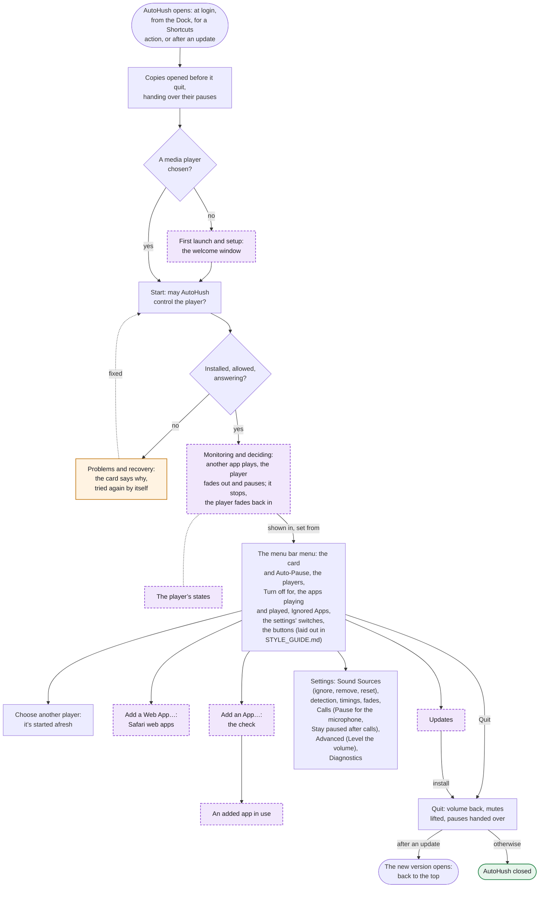

From opening to quitting. The copy of AutoHush opened last is the one that runs: any copy opened before it quits first and hands over the pauses it held. Once a player is chosen and AutoHush may control it, monitoring runs until it quits, and the menu bar menu leads to everything else. The dashed boxes are charts of their own below.

## First launch and setup

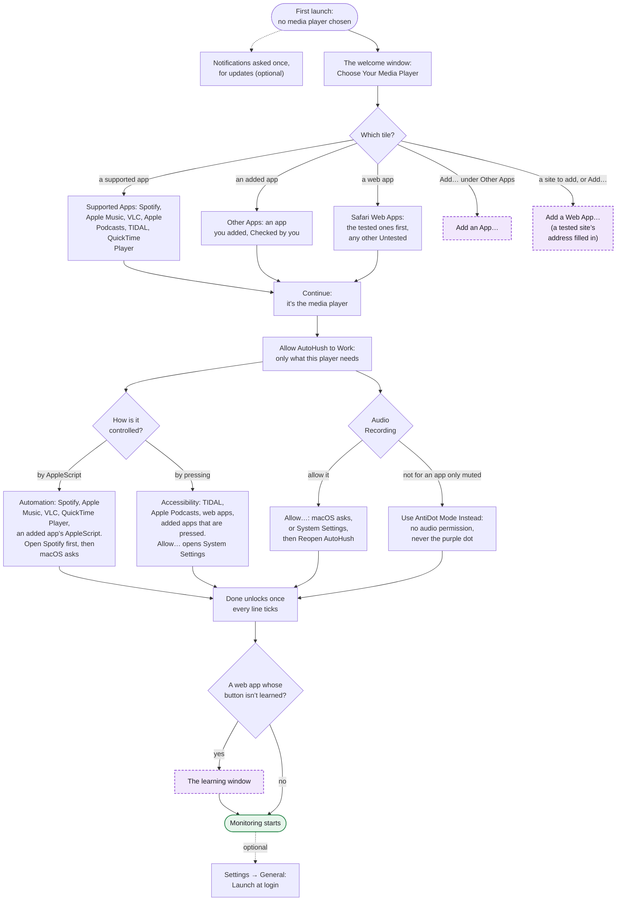

The welcome window opens whenever no media player is chosen. Its first page lists the players as tiles (dimmed when not installed; a search from eight players on). After **Continue**, its second page asks only for what that player needs, each line ticking by itself, with **Back** to change the player. A web app still to learn opens the learning window once the welcome window is done.

## Monitoring: pausing and resuming

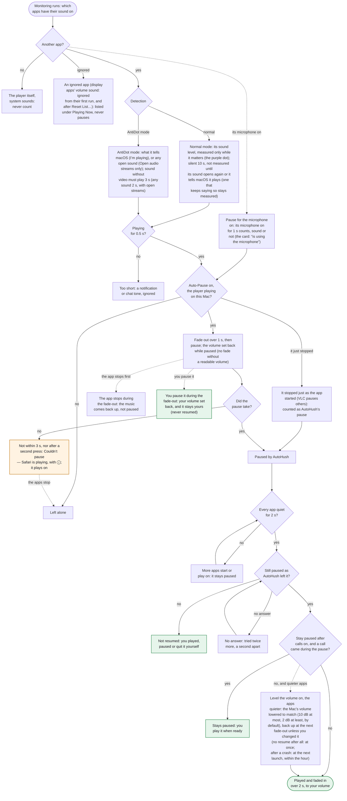

What happens each time another app plays. With several apps, the first one to play pauses the player and the last one to stop brings it back. The 0.5 s and 2 s are Settings → Detection’s timings, the fades Settings → Fades’, Pause for the microphone and Stay paused after calls Settings → Calls’, and Level the volume Settings → Advanced’s (all off by default); a call is an app using the microphone; TIDAL, Apple Podcasts, web apps and most added apps pause and play without fading. A player on another device (Spotify Connect) is never paused.

## Monitoring: what else changes it

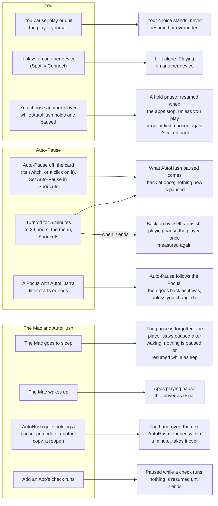

The events, besides other apps’ sound, that change what AutoHush does. Shortcuts’ **Get Auto-Pause** only reads the switch, and **Set Auto-Pause** On also ends a Turn off for. A Focus or a Shortcuts action works even when AutoHush isn’t running: macOS opens it, and a Focus that started or ended meanwhile is followed at launch.

## The player’s states

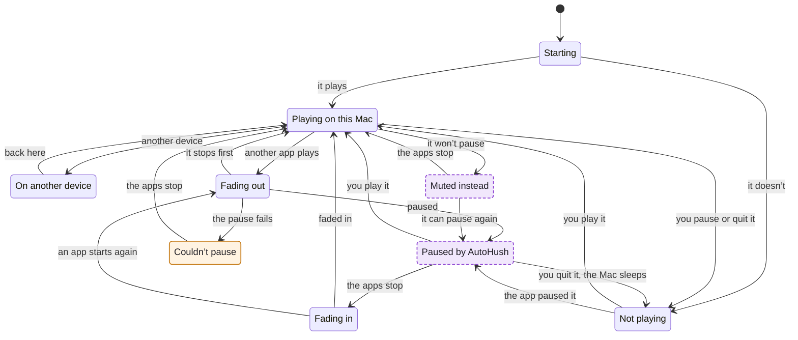

The chosen player as the menu’s card and the menu bar icon show it. **Not playing** is a player paused by you, stopped or quit: AutoHush never plays it, but takes over a pause the starting app made itself (VLC). **Muted instead** is a web app during an ad it won’t pause, or an app added as Muted only (Unmute ends it too). **The apps stop** means every other app quiet for 2 s, or Auto-Pause turned off.

## Pauses AutoHush holds

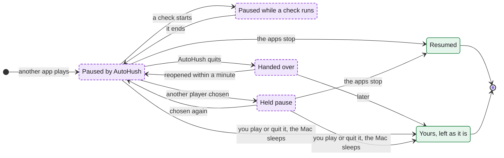

AutoHush only ever resumes a pause it holds, and it keeps holding one across a check, a change of player and a quit. A **held pause** is a player you left while AutoHush had it paused: its own monitoring runs on to end the pause. A **hand-over** is written as AutoHush quits (an update, another copy, a quick reopen) and read once by the next one.

## Safari web apps: adding one

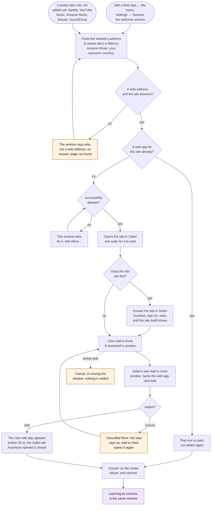

Safari’s own **Add to Dock** makes the web app; AutoHush walks you there, its window staying above other apps in the top-right corner. It asks the site once whether it answers, without cookies or a cache. Any website added to the Dock from Safari by hand is offered as a player too, marked Untested unless it’s one of the five tested sites.

## Safari web apps: learning and pausing

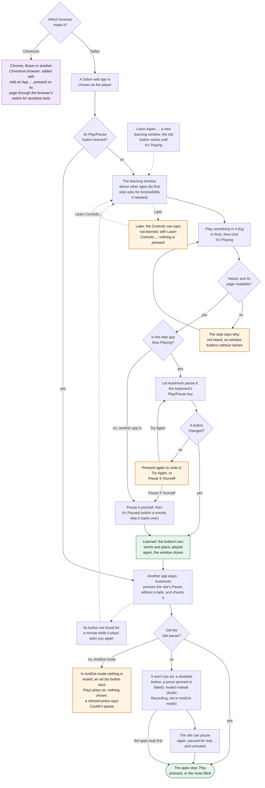

A web app can’t be scripted and has no playback menu, so AutoHush learns its Play/Pause button with you once (it keeps only the button’s two words and place), then presses it. It works with the window visible, minimized or on another desktop, and follows the window that plays. Muting during an ad uses macOS’s per-app audio taps: without Audio Recording, or in AntiDot mode, that pause fails instead.

## Add an App: before the check

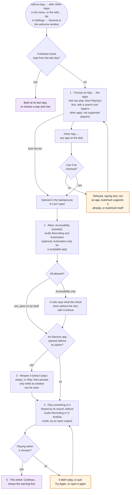

Add an App checks an app AutoHush has no support of its own for. Its window numbers the steps; **Reopen** shows only for an app built with Electron (Deezer, Qobuz…) opened without the option its page needs while covered or on another desktop. **Change…** picks another app (once the check has run, after asking, since it forgets what was found); a web app made by a Chromium browser shows that browser’s icon.

## Add an App: the check and its result

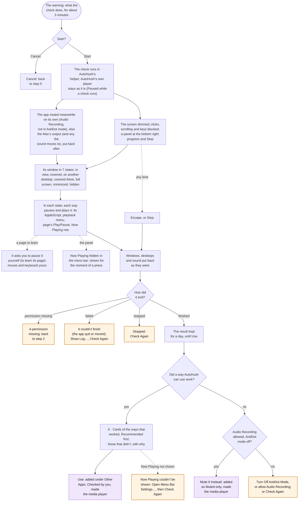

The check runs in AutoHush’s helper, playercheck, so a check that ends, stops or crashes takes its block on the mouse and keyboard with it; the pointer still moves, and the panel shows on every desktop. The ways come surest first (AppleScript, page, menu), the Now Playing panel last, since it opens on screen for a moment. **Use** keeps only the way you chose.

## An added app in use

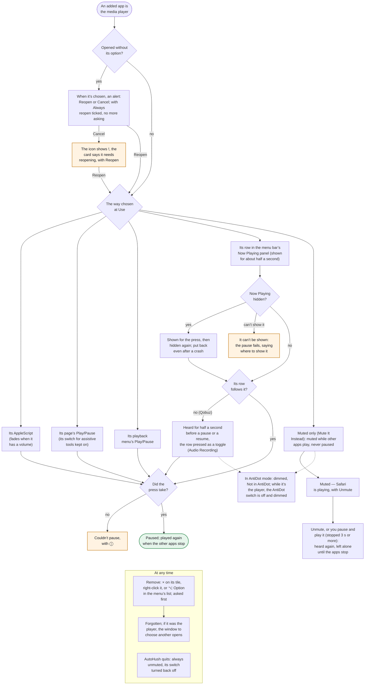

An app added with Add an App is paused and played only the one way chosen at Use, each press checked by the app’s own signs; when that way can’t (a page’s button with the window minimized, say), the pause fails and the menu says so. Only an AppleScript with a volume fades. An app that can only be muted, or whose Now Playing row needs its sound, isn’t available in AntiDot mode.

## Updates

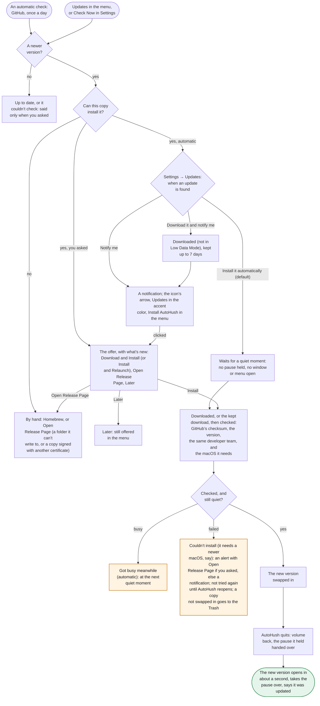

Settings → Updates sets what happens when an update is found, and can turn the automatic checks off. Notifications are optional: without them every choice still works and the menu bar icon shows the update. Settings, permissions and any pause AutoHush held carry over to the new version.

## Problems: when the player can’t start

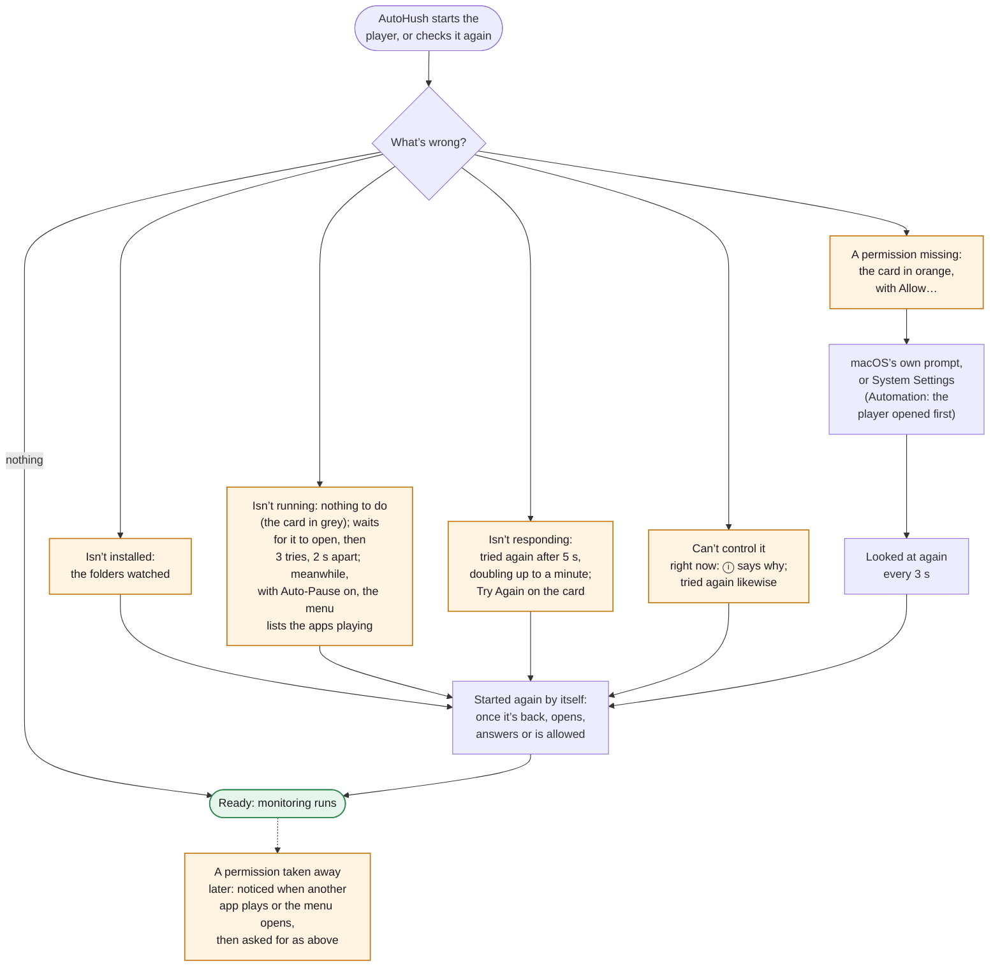

What the menu’s card says when AutoHush can’t start controlling the player, and how it recovers. Most fixes need nothing more from you: AutoHush starts again by itself, at once when the player opens or is installed again. A permission taken away while it runs is caught the next time it matters.

## Problems: while it runs, and quitting

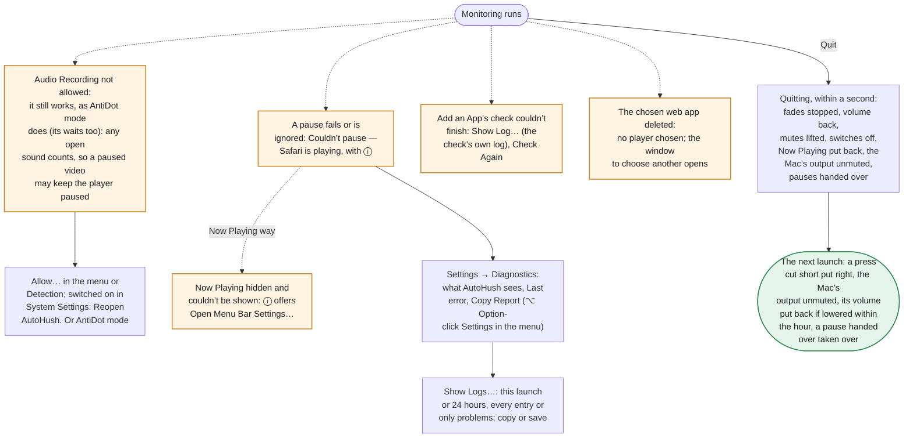

Problems that don’t stop monitoring, where to look when something seems off, and what quitting puts right. AutoHush’s own log keeps the last 24 hours in **~/Library/Logs/AutoHush**, private details left out; each check’s log is in its **Checks** folder.
